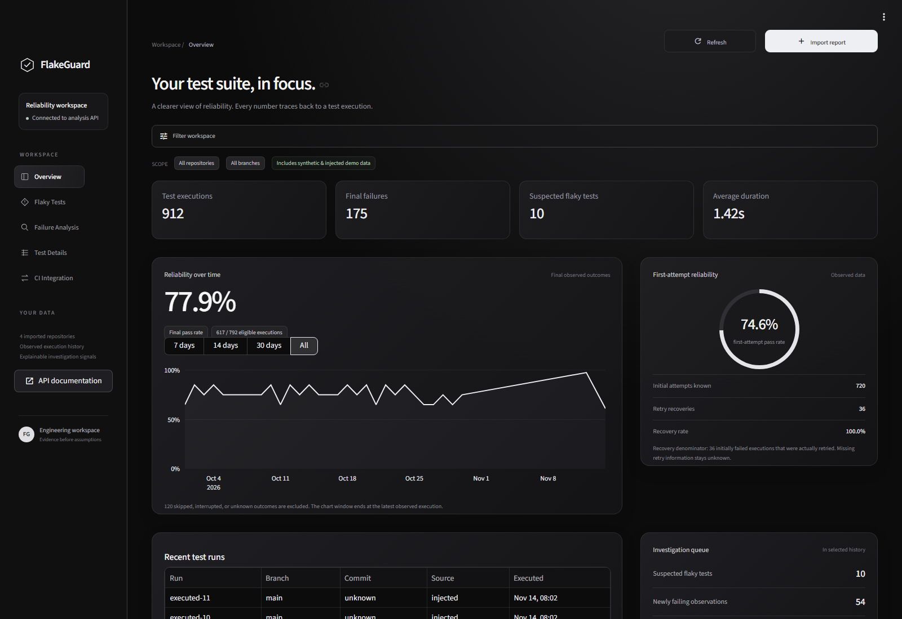
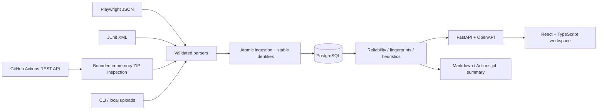

# FlakeGuard

**Turn test execution history into explainable reliability evidence.**

[](https://github.com/EliyahuEden/FlakeGuard/actions/workflows/ci.yml)

FlakeGuard imports Playwright JSON and JUnit XML, preserves observed retries, tracks recurring diagnostics, and helps engineers decide what to investigate next. A passing retry remains visible. A timeout remains ambiguous. Similar errors form investigation groups without being presented as proven shared root causes.

Built for QA Automation, SDET, and development teams that repeatedly investigate the same CI failures without useful historical context.



The workspace is a typed **React + TypeScript** single-page app (Vite, Recharts) served by the same FastAPI process, so one origin and one port run everything. It keeps the supplied graphite direction while adding keyboard-first navigation, sortable tables, a master-detail evidence view, skeleton/empty/error states, and a 390px mobile layout. See [UI design and interaction validation](docs/UI_DESIGN.md) and [publication/hosting options](docs/DEPLOYMENT.md).

## Try it locally

Requires **Python 3.13**, or Docker Engine with Compose. No paid services or GitHub credentials are needed for the demonstration. Run commands from the repository root.

### Docker Compose

```bash
cp .env.example .env
# Choose a local POSTGRES_PASSWORD in .env and update DATABASE_URL to match.
# Use URL-safe credentials, or percent-encode special characters in DATABASE_URL.
docker compose up --build -d --wait
docker compose exec api flakeguard demo --with-local
docker compose exec api python scripts/import_examples.py
```

Open [the workspace](http://127.0.0.1:8000) and [the OpenAPI explorer](http://127.0.0.1:8000/docs). Migrations run before API startup. PostgreSQL data persists in a named volume. The image builds the React app in a Node stage and serves it from the API container.

Docker Compose startup, migrations, demo seeding, health checks, and teardown passed in [hosted CI](https://github.com/EliyahuEden/FlakeGuard/actions/runs/43580648373) for the previous Streamlit revision. The React revision then passed hosted CI as well, in [run 44028897584](https://github.com/EliyahuEden/FlakeGuard/actions/runs/44028897584): frontend typecheck, Vitest and production build, the Python suite, and the Docker Compose job that builds the React image and checks `/health`, `/config` and the served page. The browser and axe checks were run locally against the SQLite demo, not in CI; Docker remains unavailable on the local Windows machine.

### Native Python and PostgreSQL

Windows PowerShell:

```powershell
py -3.13 -m venv .venv
.\.venv\Scripts\Activate.ps1
python -m pip install -r requirements-dev.lock
python -m pip install --no-deps -e .
Copy-Item .env.example .env
# Configure DATABASE_URL for an existing local PostgreSQL database.
flakeguard migrate
flakeguard demo --with-local
python scripts/import_examples.py
uvicorn flakeguard.api:app --host 127.0.0.1 --port 8000
```

Build the workspace once (Node 20.19+ or 22) and the API serves it at <http://127.0.0.1:8000>:

```powershell
cd web
npm ci
npm run build   # typechecks, then writes src/flakeguard/web
```

For frontend development run `npm run dev` in `web/` (port 5173, proxying the API on 8000). Without a build the API still works; only the browser workspace is absent.

Linux/macOS environment setup:

```bash
python3.13 -m venv .venv
source .venv/bin/activate
pip install -r requirements-dev.lock
pip install --no-deps -e .
cp .env.example .env
```

Use the same `flakeguard` and `uvicorn` commands as above after configuring PostgreSQL. An optional Windows helper can initialize a separate local cluster using an existing PostgreSQL binary distribution:

```powershell
# Run before creating .env; it generates a local password into ignored .env.
./scripts/postgres.ps1 -PostgresBin 'C:\path\to\postgres\bin'
# Stop only this FlakeGuard cluster:
./scripts/postgres.ps1 -PostgresBin 'C:\path\to\postgres\bin' -Action stop
```

The helper stores the cluster under `%LOCALAPPDATA%\FlakeGuard`, uses loopback port 54330, and creates application and isolated test databases. It requires the virtual environment and installed dependencies. PostgreSQL binaries are not bundled.

Without `.env` or `DATABASE_URL`, the explicit convenience fallback is SQLite in `.runtime/flakeguard.db`. PostgreSQL is the primary database, and database-specific tests run against PostgreSQL; SQLite is used for fast isolated tests and optional zero-service exploration.

## What works

| Capability | Implemented behavior |
|---|---|
| Ingestion | CLI, multipart HTTP API, dashboard uploads; Playwright JSON and nested JUnit XML |
| Persistence | Normalized SQLAlchemy model, Alembic migration, unique run/report/execution identities, atomic transactions |
| Reliability | Final and first-attempt rates, retry recoveries, alternation, sample thresholds, Wilson intervals, recent changes |
| Failure investigation | Versioned diagnostic normalization, exact fingerprints, bounded similarity suggestions, first-seen history |
| Classification | Explainable application, automation, infrastructure, or unknown suggestions with evidence and investigation steps |
| Analytics | Date/repository/branch/suite/browser/environment/status/provenance filters, duration and reliability trends, newly failing observations |
| GitHub Actions | Read-only manual synchronization, pagination, report ZIP import, processed-run state and retryable error state |
| CI feedback | Generated Markdown and `$GITHUB_STEP_SUMMARY` output; no quality-gate bypass |
| Workspace | Five React pages: overview, flaky tests with evidence panel, failure patterns, per-test history, CI integration; Recharts trends and execution diagnostics |
| Demonstration | Seeded report history, actual controlled pytest executions, actual CommerceGuard report projections |

## Architecture and data flow



A modular monolith keeps parsing, transactions, external I/O, and analysis independently testable. The React workspace is an HTTP client of the same API, with no database access or duplicate scoring logic; the browser formats numbers but never recomputes them. No ML model or paid API is involved; deterministic methods provide an inspectable baseline.

The database separates repositories, CI runs, report receipts, test identities, logical executions, individual attempts, failure patterns, artifacts, synchronization state, and ingestion errors. See [database design](docs/DATA_MODEL.md), [architecture decisions](docs/ARCHITECTURE.md), and the [complete file listing](docs/FILE_STRUCTURE.md).

## Import reports

```bash
flakeguard import examples/reports/commerceguard-regression.json \
  --repository portfolio/commerceguard --run-id local-regression-001 --branch main
```

Use a stable run ID when reimporting the same execution. GitHub reruns use `--run-attempt`; test retries remain separate attempts within an execution. Branch/commit/provenance conflicts or conflicting overlapping results are rejected, not silently overwritten.

The API returns 201 for successful/idempotent imports, 409 for conflicting existing observations, 422 for malformed input, and 413 for oversized reports.

```bash
curl -X POST http://127.0.0.1:8000/api/imports \
  -F 'context={"repository":"acme/shop","run_id":"123","branch":"main","provenance":"real"}' \
  -F 'file=@results.json'
```

If `FLAKEGUARD_API_KEY` is set, send `X-API-Key` for all `/api` reads and writes. The workspace asks for the key once per browser tab (kept in `sessionStorage`, sent only to its own origin) and drops it on a 401. `/config` is the only unauthenticated endpoint and exposes just the read-only and key-required flags. See `.env.example` for every setting. API validation errors omit submitted values, and imported diagnostics redact common credential patterns; avoid putting secrets in test diagnostics in the first place.

### Report semantics

- **Playwright:** nested suites/specs, project name, repeat index, observed results and retry indices, errors/stacks, timestamps, attachment metadata. Browser is read only from explicit `config.projects[].use.browserName` or provided import context. A project named `chromium` alone is not proof of browser metadata.
- **JUnit:** nested suites, testcase/classname identity, seconds converted to milliseconds, failure/error/skipped outcomes, optional explicit suite properties for environment/browser/project. Retry information is **unknown** for ordinary JUnit. Retry extensions are warned about and not guessed.
- Missing execution timestamps use clearly labeled ingestion-time fallback. Timezone-less JUnit timestamps are not assumed to be UTC.
- Missing test names and malformed documents are rejected atomically. Missing optional data remains null. Tests with no results remain `unknown`.
- Default bounds: 20 MiB report, 100,000 results, 50 MiB archive/decompressed total, 200 archive entries, compression ratio at most 200. XML entities are disabled. ZIP members are inspected in memory and never extracted.
- Import **one report format per suite/run**. JSON and JUnit may use different identities and cannot universally be reconciled. Repeated JUnit testcase identities in one report are rejected as ambiguous; provide unique parameterized names.

The Playwright reporter can be enabled with `reporter: [['json', { outputFile: 'test-results/results.json' }]]`. See the [official reporter documentation](https://playwright.dev/docs/test-reporters).

## CommerceGuard integration

CommerceGuard was available locally. Its actual `playwright.config.ts` writes both JSON and JUnit reports. FlakeGuard was tested against **119 execution records from three existing actual reports**: 117 regression records, one controlled injected failure, and one restored execution. Source relative paths, original SHA-256 hashes, provenance, and report timestamps are recorded in [the integration evidence](docs/evidence/commerceguard.json).

Bundled files are sanitized projections: machine paths, stdout/stderr, embedded attachment bodies, and unnecessary configuration are removed. These reports were ingested and tested; CommerceGuard itself was **not rerun** during this project. Its application remains independent.

```bash
python scripts/import_examples.py
# To capture the same reports again from a separate checkout:
python scripts/capture_commerceguard.py ../CommerceGuard
# To import fresh CommerceGuard output:
flakeguard import ../CommerceGuard/test-results/results.json \
  --repository your-owner/CommerceGuard --run-id your-unique-run --branch main
```

## GitHub Actions integration

Set `GITHUB_REPOSITORIES=owner/repository` on the server. For private repositories, set `GITHUB_TOKEN` to a fine-grained token limited to that repository with **Actions: read**. Public repositories can be read anonymously subject to GitHub's rate limits. No write permission is used. Permission requirements are documented by [GitHub's artifact API](https://docs.github.com/en/rest/actions/artifacts).

```bash
flakeguard sync owner/repository --max-runs 20 --artifact-pattern '*playwright-json*'
```

The dashboard also supports repository configuration and manual sync. Export JSON reports into a dedicated artifact so HTML reports, metadata JSON, and a second JUnit representation are not accidentally imported. Completed runs are checked newest first; successfully processed run attempts are skipped. Failed, missing, and partially expired imports remain visible and eligible for a later retry. Sync is synchronous and bounded to the selected recent runs, not an unattended scheduler.

```yaml
- uses: actions/upload-artifact@v4
  if: always()
  with:
    name: playwright-json-results
    path: test-results/results.json
```

To generate feedback against persistent history:

```bash
flakeguard summary 1 --output quality-summary.md
# Inside GitHub Actions:
flakeguard summary 1 --github-summary
```

See [the workflow example](examples/github/quality-summary.yml) and [sample summary](docs/evidence/sample-summary.md). Keep the test step's original exit status: FlakeGuard never makes suspected flaky failures harmless. Authenticated synchronization is transport-tested and was also exercised live on 17 November against `EliyahuEden/CommerceGuard`: it downloaded the `playwright-json-results` artifact from two hosted regression runs and imported 156 executions from each, and recorded a third run without that artifact as a retryable error. It used a read-only-scope token in a local scratch database. PR comments and scheduled background sync are not implemented.

## Analysis methodology

An eligible outcome is `passed`, `failed`, or `timedOut`. Skipped, interrupted, and unknown outcomes are counted but excluded from pass/fail rates.

| Metric | Formula |
|---|---|
| Final pass rate | final passed executions / eligible executions |
| Failure rate | final failed or timed-out executions / eligible executions |
| First-attempt pass rate | observed initial passes / eligible executions with explicit eligible initial attempt |
| Retry recovery rate | observed initially failed executions finally passing after retries / observed initially failed executions actually retried |
| Reliability score | 100 × (final passes − observed retry recoveries) / eligible executions |
| Suspicion score | 100 × (0.7 × retry recoveries / known retry observations + 0.3 × across-run alternation fraction) |
| Average duration | mean sum of attempt durations over eligible executions with complete duration data |

No denominator means null, not zero. Unknown retries may make reliability look better than reality; the UI shows known retry observation counts. At least five eligible observations across three distinct runs are required for a reliability label. Two retry recoveries, or repeated final outcome alternation meeting a suspicion threshold, can trigger `suspected_flaky`. Consistent final failure remains separately labeled. Low-frequency intermittent failures may stay below the threshold.

History is partitioned by branch, explicit browser/environment, and provenance. Project is part of the test identity. Browser differences are inspectable rather than pooled into artificial flakiness. A fingerprint hashes normalized diagnostic text with an algorithm version; similarity suggestions never merge exact groups. Classification evidence strength is qualitative, not a calibrated probability. Assertion failures alone do not prove an application defect. Full formulas, thresholds, and caveats are in [the analysis methodology](docs/ANALYSIS_METHODOLOGY.md).

## Dashboard walkthrough

1. **Overview:** execution counts, denominators, pass/failure rates, reliability trend, recent runs, suite/branch/browser breakdowns, and newly failing observations.
2. **Flaky Tests:** searchable cohort rows with sample size, recovery evidence, reliability/suspicion scores, priority, and calculation explanations.
3. **Failure Analysis:** recurring fingerprints, first/last occurrence, affected tests, classifications, supporting evidence, suggested steps, and diagnostic examples.
4. **Test Details:** execution history, duration/status charts, retry attempts, related fingerprints, CI links, and artifact metadata.
5. **CI Integration:** local report upload, allowlisted repository configuration, manual sync, import receipts, warnings, and errors.

All pages share filters. Selecting only failed statuses can bias history analysis; the dashboard displays a warning. Screenshots are [generated by the live browser check](docs/evidence/browser-check.json), not mockups.

Screenshots: [Flaky Tests](docs/evidence/screenshots/flaky-tests.png) · [Failure Analysis](docs/evidence/screenshots/failure-analysis.png) · [Test Details](docs/evidence/screenshots/test-details.png) · [CI Integration](docs/evidence/screenshots/ci-integration.png).

## Reproducible demonstration and evaluation

```bash
flakeguard demo --with-local
python scripts/import_examples.py
flakeguard evaluate --output docs/evidence/evaluation.json
```

- **Synthetic:** 30 seeded daily runs × 12 scenarios × 2 explicit browsers = **720 executions**. Includes passing, deterministic regression, retry-recovered timing/connection failures, shared state, setup failures, browser-specific behavior, new regression, duration growth, skipped, unknown, and rare failures. Browser behavior here is simulated report data, not an executed cross-browser suite.
- **Executed with injected conditions:** 12 actual pytest runs × 6 cases = **72 execution records**. Includes a real loopback TCP connection refusal and controlled assertion, scheduler-model timing, state, and fixture failures. JUnit correctly leaves retries unknown. Intentional failing tests are outside the platform's default test paths.
- **Actual CommerceGuard reports:** 119 records, with 118 ordinary records and one injected defect record; imported independently of the synthetic demo.

The synthetic demo is idempotent. Existing executed demo runs are not rerun with changed durations; to regenerate them explicitly:

```bash
flakeguard reset-demo
flakeguard demo --with-local
```

Reset only removes runs marked `source=demo` in reserved demo repositories. It preserves ordinary imported projects.

Measured results are stored in [evaluation JSON](docs/evidence/evaluation.json) and summarized in [validation evidence](docs/VALIDATION.md). The small synthetic diagnostic dataset achieved **29/32 correct classifications (90.625% accuracy), 93.18% macro precision, and 90.625% macro recall**. Three ambiguous injected cases were classified unknown. The intermittent-scenario detector identified **3/4 scenario types (100% precision, 75% recall)**. Fingerprint normalization correctly grouped/separated **12/12 authored diagnostic pairs**. These are synthetic evaluation results, not estimates of real-world root-cause accuracy.

## Validate the platform

```bash
pytest
ruff check .
ruff format --check .
mypy src/flakeguard
alembic check
```

PostgreSQL validation uses an isolated database whose name contains `test`:

```powershell
# Local helper initializes flakeguard_test using the same ignored local credentials.
python scripts/create_databases.py
python scripts/check_postgres.py
```

For an already configured test database, set `FLAKEGUARD_TEST_DATABASE_URL`, run migrations against that database, then run pytest. Never point it at application data. Live API/browser checks require running services and seeded demo data:

```powershell
$env:FLAKEGUARD_E2E='1'
pytest tests/e2e -q
python -m playwright install chromium
python scripts/browser_check.py
```

The browser check visits every page, saves screenshots, uploads a report through the UI, and verifies API persistence. The upload uses a reserved `e2e/browser-validation` repository. See [test strategy](docs/TEST_STRATEGY.md) for isolation, coverage scope, and regression cases. Both the PostgreSQL validation and Docker Compose jobs passed in [the recorded hosted workflow](https://github.com/EliyahuEden/FlakeGuard/actions/runs/43580648373).

The recorded PostgreSQL validation results and exact coverage scope are in [the complete validation report](docs/VALIDATION.md). All five pages passed browser verification with **zero axe-core violations** (WCAG 2.0/2.1/2.2 A and AA automated rules; not a certification); `scripts/ui_interactions.py` also checks the skip link, keyboard navigation with heading focus, API-backed filters, CSV export, evidence deep links, and the 390px layout. The frontend has its own `npm run typecheck`, `npm test` (Vitest) and `npm run build` gates in CI. Browser/CLI subprocess execution is tracked separately from pytest line coverage.

## Known limitations and next steps

- An internal single-user tool: shared API key, no per-user roles, tenant isolation, SSO, or audit-grade access control. Services bind to loopback by default. Add an authenticated TLS reverse proxy before shared hosting.
- Heuristics suggest investigation, not causality. No calibrated defect probability, automated quarantine, failure suppression, or commit bisection. Expected Playwright failures are preserved as metadata but raw observed failure rates still include them.
- Analysis loads selected history in memory; historical checks can issue multiple queries. Appropriate for the demonstrated scale, not yet benchmarked for millions of results. Similarity suggestions are capped at 200 patterns.
- Unknown timestamps/retries/environments reduce evidence quality. Plain JUnit cannot reliably represent retry behavior. Cross-format deduplication and merged multi-shard retry sequences need producer-specific contracts.
- GitHub sync uses a bounded recent-run window, no scheduler or continuation cursor. Rate-limit errors expose safe retry metadata; no automatic long sleeps. Changes to an artifact on an already processed run are not automatically revisited.
- Artifact **metadata** is stored; screenshots/videos/traces are not hosted or opened by the server. CI run links lead to authorized diagnostic downloads.
- Diagnostic redaction handles common credential formats, not arbitrary business secrets. Treat reports as sensitive internal engineering data.
- Hosted Linux/PostgreSQL and Docker Compose CI are verified. Public application hosting remains unverified (live GitHub artifact synchronization was verified once, as described above). Browser-specific demo behavior is synthetic. CommerceGuard outputs are existing executions, not a fresh CommerceGuard run.

Future work: producer-specific retry-aware JUnit adapters, larger independently labeled evaluation sets, query pagination/materialized analytics, background sync checkpoints, authenticated artifact storage, and identity migration for test renames.

## Portfolio material

Three measured [resume bullets](docs/RESUME_BULLETS.md), an [interview explanation](docs/INTERVIEW.md), [commands executed](docs/COMMANDS_EXECUTED.md), and a [full file structure](docs/FILE_STRUCTURE.md) are included. Source is published at [EliyahuEden/FlakeGuard](https://github.com/EliyahuEden/FlakeGuard). External application hosting is a separate step; see [deployment options](docs/DEPLOYMENT.md).
