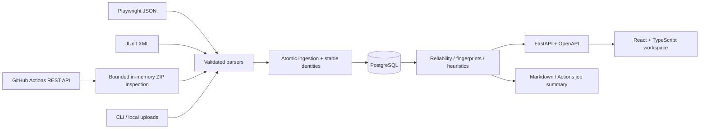
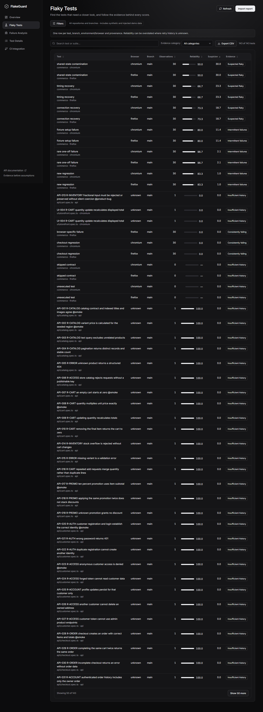

# FlakeGuard

[](https://github.com/EliyahuEden/FlakeGuard/actions/workflows/ci.yml)

**Turn test execution history into explainable reliability evidence.** FlakeGuard
imports Playwright and JUnit reports, keeps every retry visible, and shows which tests
are flaky, which failures keep coming back, and what to investigate next, with the
numbers and reasoning behind each answer.


## The problem

CI tells you whether a run passed, not whether a test can be trusted. A test that fails
and then passes on retry looks green, a timeout could be the app or the infrastructure,
and the same error gets re-investigated every week because nobody kept the history.
FlakeGuard keeps that history and answers three questions: *which tests are unreliable,
which failures are the same, and where should I look first.* It is built for QA
automation engineers, SDETs and developers who spend time triaging CI failures.

It is deliberately honest about uncertainty: a passing retry stays visible, a timeout
stays ambiguous, similar errors form investigation groups without being presented as a
proven shared root cause, and missing data stays "unknown" rather than becoming zero.

## What it does

| Capability | Behavior |
| --- | --- |
| Ingestion | Playwright JSON and nested JUnit XML through the CLI, an HTTP API, workspace upload or GitHub Actions artifacts |
| Persistence | Normalized model on PostgreSQL, atomic imports, stable identities, idempotent re-imports |
| Reliability | Final and first-attempt pass rates, retry recoveries, alternation, sample thresholds, Wilson intervals |
| Failure investigation | Versioned diagnostic normalization, fingerprints, similarity suggestions, first-seen history |
| Classification | Application, automation, infrastructure or unknown suggestions, each with evidence and next steps |
| Analytics | Filters by repository, branch, suite, browser, environment, status, provenance and date, with trends |
| CI feedback | Markdown and `$GITHUB_STEP_SUMMARY` output that never bypasses a quality gate |

## How it works



A modular monolith keeps parsing, transactions, external I/O and analysis independently
testable. The React workspace is an HTTP client of the same API, with no database access
and no duplicate scoring logic: the browser formats numbers but never recomputes them.
No ML model or paid service is involved; deterministic methods give an inspectable
baseline. See the [architecture decisions](docs/ARCHITECTURE.md), the
[database design](docs/DATA_MODEL.md) and the [file listing](docs/FILE_STRUCTURE.md).

## The workspace

A typed React and TypeScript app (Vite, Recharts) served by the same FastAPI process,
so one port runs everything. It offers keyboard-first navigation, sortable tables, an
evidence panel beside each score, loading, empty and error states, and a 390px mobile
layout. All five pages pass automated axe-core checks (not an accessibility
certification). See [UI design](docs/UI_DESIGN.md).

1. **Overview:** counts and denominators, reliability trend, recent runs, the investigation queue and the suites that need attention.
2. **Flaky Tests:** searchable, sortable evidence per test with reliability and suspicion scores and the calculation behind them.
3. **Failure Analysis:** recurring failure patterns with affected tests, classification, supporting evidence and suggested steps.
4. **Test Details:** one test's execution history, duration and outcome charts, retry attempts and diagnostics.
5. **CI Integration:** report upload, GitHub synchronization and an activity log of imports and errors.



More: [Failure Analysis](docs/evidence/screenshots/failure-analysis.png) ·
[Test Details](docs/evidence/screenshots/test-details.png) ·
[CI Integration](docs/evidence/screenshots/ci-integration.png) ·
[mobile](docs/evidence/screenshots/mobile-overview.png).

## Quick start

No paid services or GitHub credentials are needed. Run from the repository root.

**Docker Compose** (needs Docker with Compose):

```bash
cp .env.example .env
# Choose a local POSTGRES_PASSWORD in .env and update DATABASE_URL to match.
docker compose up --build -d --wait
docker compose exec api flakeguard demo --with-local
docker compose exec api python scripts/import_examples.py
```

Open the workspace at <http://127.0.0.1:8000> and the OpenAPI explorer at
<http://127.0.0.1:8000/docs>. Migrations run before the API starts, and the image
builds the React app in its own Node stage.

**Native Python 3.13** (SQLite is used when no `DATABASE_URL` is set):

```bash
python -m venv .venv && source .venv/bin/activate    # Windows: .\.venv\Scripts\Activate.ps1
pip install -r requirements-dev.lock && pip install --no-deps -e .
(cd web && npm ci && npm run build)                  # Node 20.19+ or 22
flakeguard migrate && flakeguard demo --with-local
uvicorn flakeguard.api:app --host 127.0.0.1 --port 8000
```

PostgreSQL setup, a Windows helper, frontend development mode and the full check
commands are in [LOCAL_SETUP](docs/LOCAL_SETUP.md).

## Using it

Import a report:

```bash
flakeguard import results.json --repository owner/project --run-id run-001 --branch main
```

Pull reports from GitHub Actions, or post a summary back into a workflow:

```bash
flakeguard sync owner/repository --max-runs 20 --artifact-pattern '*playwright-json*'
flakeguard summary 1 --github-summary
```

Details: [report formats and the HTTP API](docs/REPORT_FORMATS.md) and
[GitHub Actions integration](docs/GITHUB_INTEGRATION.md). It pairs naturally with
[CommerceGuard](https://github.com/EliyahuEden/CommerceGuard), whose weekly regression
uploads exactly the artifact FlakeGuard syncs.

## How reliability is scored

An eligible outcome is `passed`, `failed` or `timedOut`; skipped, interrupted and
unknown outcomes are counted but excluded from rates.

| Metric | Formula |
| --- | --- |
| Final pass rate | final passed executions / eligible executions |
| First-attempt pass rate | observed initial passes / eligible executions with a known initial attempt |
| Retry recovery rate | initially failed executions that finally passed / initially failed executions actually retried |
| Reliability score | 100 × (final passes − observed retry recoveries) / eligible executions |
| Suspicion score | 100 × (0.7 × retry recoveries / known retry observations + 0.3 × across-run alternation fraction) |

No denominator means null, not zero. A reliability label needs at least five eligible
observations across three distinct runs. History is partitioned by branch,
browser or environment and provenance, so differences stay inspectable instead of being
pooled into artificial flakiness. Classification evidence is qualitative, not a
calibrated probability. Full formulas and caveats:
[ANALYSIS_METHODOLOGY](docs/ANALYSIS_METHODOLOGY.md).

## Validation

| Check | Result |
| --- | --- |
| Python tests | 104 passed, 2 skipped (live API and PostgreSQL-only cases run separately); ruff and strict mypy clean |
| Frontend | TypeScript check, Vitest and production build pass in CI |
| Hosted CI | Python validation and the Docker Compose job (building the React image) pass |
| Browser checks | 5 pages with zero axe-core violations, keyboard, filter, export and mobile interaction checks (run locally) |
| Real-data integration | 119 records from CommerceGuard reports; a live GitHub sync imported 156 executions per hosted run |
| Heuristic evaluation | 90.6% classification accuracy on 32 synthetic cases; 3 of 4 injected intermittent scenario types found |

The evaluation figures are on **synthetic** data the author wrote; they show the
heuristics behave as designed, not real-world accuracy. Details and dated records:
[VALIDATION](docs/VALIDATION.md), [DEMO_AND_EVALUATION](docs/DEMO_AND_EVALUATION.md)
and [TEST_STRATEGY](docs/TEST_STRATEGY.md).

## Limitations

- An internal single-user tool: shared API key, no per-user roles, tenants or SSO. Services bind to loopback by default; put an authenticated TLS proxy in front before sharing.
- Heuristics suggest where to investigate, not causes. There is no automated quarantine, failure suppression or bisection.
- Analysis loads the selected history in memory, which suits the demonstrated scale and has not been benchmarked for millions of results.
- Unknown timestamps, retries or environments reduce evidence quality, and plain JUnit cannot represent retries.
- GitHub sync is bounded to recent runs with no scheduler. Artifact metadata is stored, but screenshots, videos and traces are not hosted.
- Diagnostic redaction handles common credential formats, not arbitrary business secrets.

Future work: retry-aware JUnit adapters, larger independently labeled evaluation sets,
query pagination, background sync checkpoints, authenticated artifact storage and
identity migration for test renames.

## Documentation

[docs/README.md](docs/README.md) maps everything, including the
[resume bullets](docs/RESUME_BULLETS.md) and an [interview explanation](docs/INTERVIEW.md).
See [LICENSE](LICENSE) for terms.
