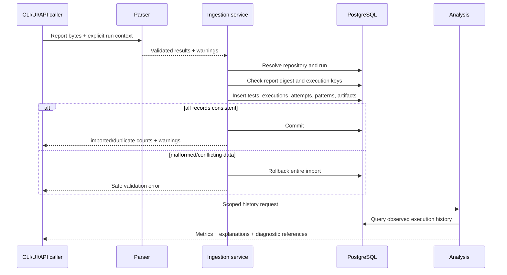

# Architecture

## Engineering problem

A red CI build describes an outcome, not a diagnosis. Retries can hide instability; unrelated tests can fail together because a dependency is down; text changes can obscure recurring patterns. FlakeGuard preserves executions and their evidence so engineers can investigate these differences.

## Decisions

| Decision | Reason and tradeoff |
|---|---|
| Modular monolith | One Python package, API process, dashboard process, and database; fewer operational dependencies than microservices |
| PostgreSQL + SQLAlchemy + Alembic | Relational constraints and explicit schema evolution; SQLite is only an optional convenience/test backend |
| Logical execution separate from attempt | A failed attempt followed by pass must not become two independent observations |
| Producer-supplied retry metadata | Unknown is preferable to fabricated first-attempt statistics |
| Stable semantic identity | Repository/project/suite/file/title hash survives line changes and commits; renames intentionally create new identities |
| Versioned deterministic fingerprints | Reproducible and inspectable; text equivalence does not establish root cause |
| Qualitative heuristic strength | Avoids misleading calibrated confidence claims without representative labeled data |
| React workspace (HTTP client of the same API) | Backend remains independently usable; UI has no DB credentials or alternate analysis path |
| Synchronous bounded GitHub sync | Manual operation is easy to inspect and test; long-term unattended synchronization needs a worker/checkpoint design |
| No machine learning | No demonstrated incremental benefit over deterministic baselines in this dataset |

## Component boundaries

`parsers.py` validates untrusted report structure and produces Pydantic DTOs. It does not write to the database. `ingestion.py` resolves identities and writes one transaction. `failures.py` provides pure normalization/classification functions. `analytics.py` scopes history, computes metrics, and produces explanation evidence. `github.py` owns external HTTP, archive validation, and run synchronization state. `api.py` exposes these services through validated routes. `summary.py` and `dashboard.py` present the same backend results. `demo.py` generates reports that pass through ordinary ingestion.

## Transaction and concurrency contract

Run identity is repository/external ID/run attempt. Report identity is run/content SHA-256. Execution identity is run/test/repeat/environment key. Uniqueness constraints arbitrate concurrent writers. An identical committed import is idempotent; a race that hits a uniqueness constraint is rolled back and returns a retryable conflict message. Conflicting observations are rejected instead of overwritten. No attempt is silently merged into a previously stored execution.

Local uploads commit one report atomically. GitHub sync commits supported reports for a run together; malformed reports roll back that run's new data while earlier processed runs remain committed. Sync errors are saved separately after rollback. Partial artifact availability is not marked fully processed.

## Security and resource boundaries

- Optional shared API key protects every `/api` read and write; public health/OpenAPI expose no diagnostics or credentials.
- GitHub allowlist is server-owned, separate from repository UI configuration. Token is an environment secret and not accepted as request input.
- Token is sent to `api.github.com` only. Signed HTTPS storage redirects use a domain allowlist and no Authorization header.
- HTTP timeouts, body limits, XML entity protection, archive entry/byte/compression limits, and no disk extraction constrain untrusted input.
- Common diagnostic credentials are redacted before storage. Artifact bodies and report stdout/stderr are not persisted.
- No shell commands or downloaded test artifacts are executed by ingestion. Only the explicitly invoked local demonstration runs its own bundled pytest suite.

## Operational scope

Docker Compose orchestrates database readiness, one-off migration, API readiness, and dashboard startup. Native validation used PostgreSQL on loopback and Python 3.13. Analysis is currently request-time and memory-based. No cache invalidation layer, background queue, distributed transaction, retention policy, or multi-tenant boundary is claimed.
