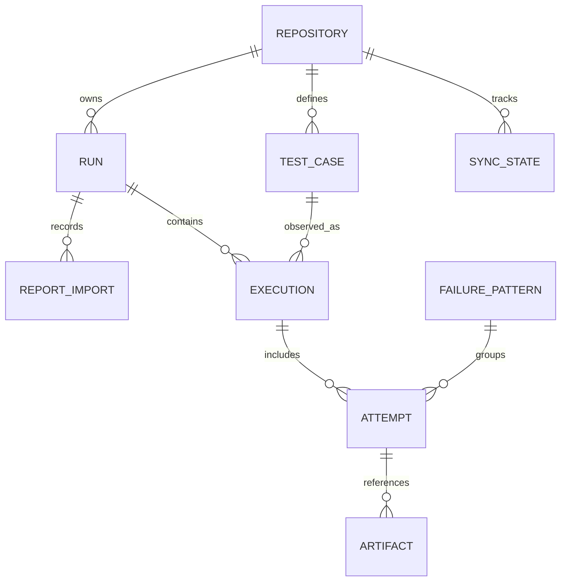

# Data model

| Table | Purpose | Important identity or fields |
|---|---|---|
| `repositories` | Local or GitHub project scope | Unique normalized name; server-authorized GitHub-enabled flag |
| `runs` | CI/local build invocation | Unique repository + external ID + run attempt; branch, SHA, source, provenance, execution time and timestamp source, CI URL |
| `report_imports` | Content receipt | Unique run + SHA-256 digest; format, filename, parser warnings, import time |
| `test_cases` | Logical semantic test identity | SHA-256 of JSON array repository/project/suite/file/name; case preserved except repository, path separators normalized |
| `executions` | One observed logical test in a run | Unique run/test/repeat index/environment key; final status, total attempt duration, browser/environment, expected status, observed retry summaries |
| `attempts` | Individual actual attempt | Unique execution/ordinal; source retry index, status, duration, source start time, redacted message/stack, failure fingerprint |
| `failure_patterns` | Exact normalized diagnostic groups | Fingerprint key, normalized text, algorithm version |
| `artifacts` | Diagnostic metadata | Attempt/name/content type/source path; body excluded; no local file serving |
| `sync_states` | Manual GitHub incremental skip/error state | Unique repository/external run/run attempt; status/detail/update time |
| `ingestion_errors` | Safe upload error inspection | Error description and time, no raw submitted report |

Foreign keys are enforced on both PostgreSQL and SQLite tests. Repository/test/run/status/time and failure-fingerprint queries have indexes. One execution can have zero attempts (unknown result), one ordinary attempt, or multiple explicitly observed attempts. Retries are not additional historical executions.

## Nullable evidence

`browser`, `environment`, `commit_sha`, per-attempt timestamps, durations, and diagnostics may be unknown. `retries`, `first_attempt_pass`, and `retry_recovered` remain null unless enough explicit source retry information exists. Zero retries and unknown retries mean different things. Duration is null if no attempts exist or any attempt duration is missing. It is not silently filled with zero.

`executed_at` must exist for ordering. Context timestamp wins over report timestamp; otherwise ingestion time is used and `timestamp_source=ingestion` makes the fallback visible. API-supplied timestamps and filters must contain timezones. PostgreSQL stores timezone-aware values; responses normalize to ISO dates.

## Identity limitations

The identity excludes line numbers, commit, branch, and producer-generated ephemeral spec IDs. Project separates API, desktop, mobile, and browser variants. Browser/environment live on execution records and partition reliability cohorts. Changes to suite/title/file/project represent identity changes; rename mapping is future work. Playwright and JUnit identities are not automatically reconciled because their report contracts differ. Use one representation per suite/run. Duplicate indistinguishable JUnit cases are rejected, not assigned invented repetition numbers.
